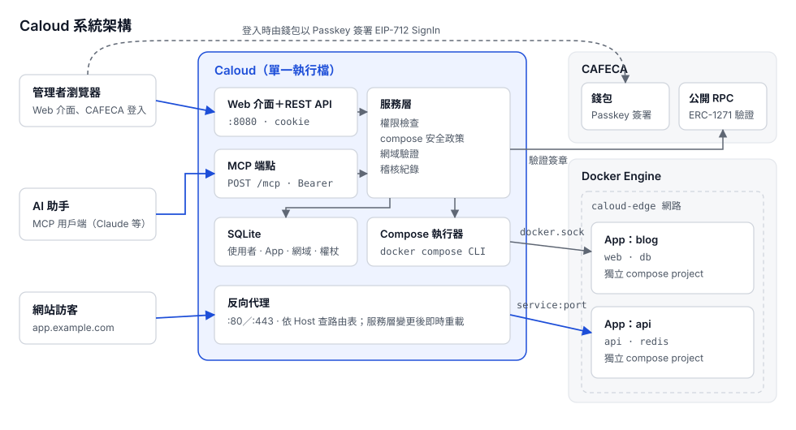
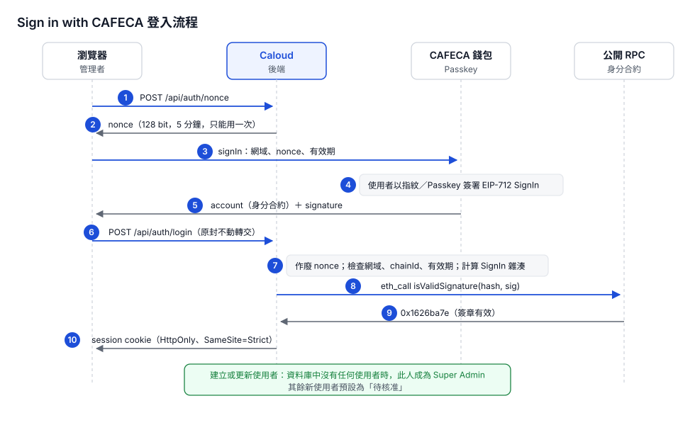
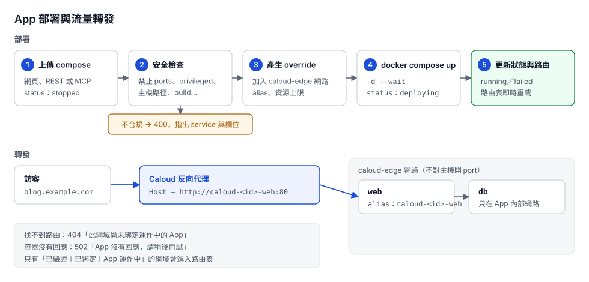
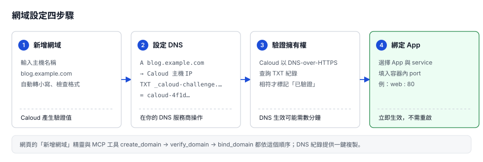
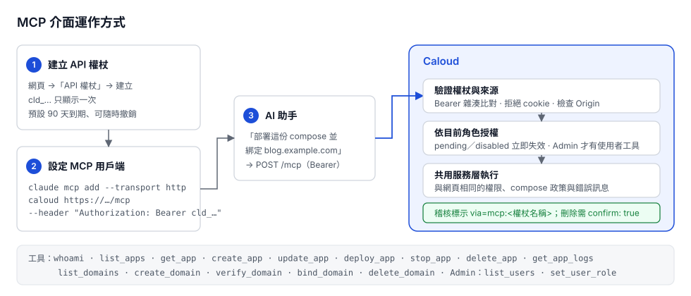

# Caloud

**自架的容器托管平台。** 用 CAFECA 身分登入網頁，上傳一份 docker compose 檔就能立即啟動服務，再把自己的網域轉發過去；也可以讓 Claude 等 AI 助手透過 MCP 代為操作。

以 Rust 開發，**單一執行檔**同時提供管理介面、REST API、MCP 端點與反向代理。



---

## 目錄

- [適合誰](#適合誰)
- [功能](#功能)
- [運作原理](#運作原理)
- [部署](#部署)
- [操作](#操作)
- [設定](#設定)
- [疑難排解](#疑難排解)
- [專案結構與開發](#專案結構與開發)
- [目前限制與路線圖](#目前限制與路線圖)

## 適合誰

- 有一台 Docker 主機，想讓團隊成員**自助部署**內部工具（Metabase、Grafana、部落格、API 服務…），又不想給每個人 SSH 與 root 權限。
- 想用 **CAFECA 身分**統一登入，不另外管理帳號密碼。
- 想讓 **AI 助手**直接幫忙部署、查 log、設定網域。

## 功能

| 功能 | 說明 | 狀態 |
| --- | --- | --- |
| CAFECA 登入 | Passkey 簽署，後端以公開 RPC 驗證；不需 API key、不需向 CAFECA 註冊 | ✅ |
| 第一位登入者即 Super Admin | 部署後第一個登入的人自動取得最高權限；之後的人預設「待核准」 | ✅ |
| 上傳 compose 即時啟動 | 安全檢查 → 加入隔離網路 → `docker compose up`，狀態即時更新 | ✅ |
| 網域托管與轉發 | DNS TXT 驗證擁有權後，把網域轉發到 App 的 service:port，不需重啟 | ✅ |
| 管理介面 | 總覽、Apps、網域、使用者、API 權杖；淺色／深色 | ✅ |
| MCP 介面 | AI 助手以個人 API 權杖經 `POST /mcp` 操作 16 個工具 | ✅ |
| 稽核紀錄 | 登入、部署、網域、角色、權杖變更皆有紀錄，標示來源（網頁／MCP） | ✅ |
| HTTPS 自動憑證 | Let's Encrypt（ACME HTTP-01） | M2 規劃中 |
| WebSocket 轉發、即時 log、資源配額 | | M2–M3 規劃中 |

## 運作原理

### 1. 登入：Sign in with CAFECA

CAFECA 身分是一個鏈上的智能合約帳戶，由使用者裝置上的 Passkey 控制。Caloud 不保存任何密碼：



- **防重放**：nonce 由 Caloud 產生，5 分鐘內有效且只能用一次。
- **防仿冒網站**：使用者簽署的訊息包含 Caloud 的網域，換到別的網站使用會驗證失敗。
- **不信任任何第三方**：Caloud 自己計算 EIP-712 雜湊，直接向公開 RPC 呼叫使用者身分合約的 `isValidSignature` 驗證。
- **使用者 ID** 就是身分合約地址，換裝置或恢復帳戶後都不變。
- **第一位登入者**：建立使用者時以單一 SQL 陳述式判斷「資料庫是否還沒有任何使用者」，兩人同時登入也只會有一位成為 Super Admin（[ADR 0004](docs/adr/0004-first-login-super-admin.md)）。

### 2. 部署與流量轉發



- **一個 App ＝ 一個 compose project**，名稱為 `caloud-<id 前 12 碼>`，App 之間網路互相隔離。
- **安全檢查**：Caloud 需要存取 docker.sock（等同主機 root），所以會拒絕可能逃逸到主機的設定，例如 `ports`、`privileged`、`cap_add`、`network_mode: host`、主機路徑掛載、`build`、`env_file`。完整清單見[安全規範 §3](docs/07-security.md#3-compose-政策)。
- **override**：Caloud 替每個 service 加上 `caloud-edge` 網路與 alias `caloud-<id>-<service>`、記憶體與程序數上限、`restart: unless-stopped`。容器不對主機開 port，只能經由 Caloud 的反向代理被存取。
- **熱更新路由**：只有「網域已驗證、已綁定、App 運作中」才進入路由表；任何變更後立即重新載入，不中斷進行中的連線。

### 3. 網域驗證



必須先證明你擁有網域（TXT 紀錄）才能讓它轉發流量，避免有人綁定別人的網域。

### 4. MCP：讓 AI 助手操作 Caloud



- MCP 用戶端無法完成瀏覽器中的 Passkey 簽署，所以改用在網頁建立的**個人 API 權杖**（[ADR 0008](docs/adr/0008-mcp-interface.md)）。
- 權杖代表你本人，權限永遠等於你**目前**的角色；被改為待核准或停用時立即失效。
- MCP 與網頁共用同一個服務層，權限、compose 安全檢查、錯誤訊息完全一致。

## 部署

### 需求

| 項目 | 版本 |
| --- | --- |
| Linux 主機 | 可對外提供 80 port（給 App 網域使用） |
| Docker Engine | 24 以上 |
| Docker Compose plugin | 2.20 以上（需要 `--wait`） |
| 網域 | 每個要托管的網域都要能設定 A 與 TXT 紀錄 |

### 用 Docker Compose 部署（建議）

```bash
git clone <此 repo> caloud && cd caloud
cp deploy/.env.example deploy/.env      # 依下方說明修改
docker compose -f deploy/docker-compose.yml up -d --build
docker compose -f deploy/docker-compose.yml logs -f caloud
```

`deploy/docker-compose.yml` 會：

- 對外開放 `80`（App 網域的流量）與 `443`（M2 啟用 HTTPS 後使用）
- 管理介面 `8080` **只綁定在主機的 127.0.0.1**
- 掛載 `/var/run/docker.sock`，並把資料存在 `caloud-data` volume（SQLite、compose 檔）
- 建立 `caloud-edge` 網路，Caloud 與所有 App 容器都會加入

### 連到管理介面

CAFECA 簽章會綁定管理介面的網址，所以 `CALOUD_PUBLIC_ORIGIN` 必須**和瀏覽器網址列完全相同**；CAFECA 只接受 `https://` 或本機的 `http://localhost`。

在 HTTPS 支援完成（M2）之前，請用 SSH 通道連到管理介面：

```bash
# deploy/.env
CALOUD_PUBLIC_ORIGIN=http://localhost:8080

# 你的電腦
ssh -L 8080:localhost:8080 <主機>
# 瀏覽器開啟 http://localhost:8080
```

M2 之後可改為 `CALOUD_PUBLIC_ORIGIN=https://caloud.example.com`，由 Caloud 自動申請憑證。

### 第一次登入

> [!IMPORTANT]
> 部署完成後**立即**登入。第一個登入的人會成為 Super Admin，且無法轉移。

1. 開啟管理介面 →「以 CAFECA 登入」→ 在 CAFECA 錢包確認並以 Passkey 簽署。
2. 你現在是 Super Admin。之後登入的人會出現在「使用者」頁等待核准。

### 備份與升級

| 工作 | 做法 |
| --- | --- |
| 備份 | 備份 `caloud-data` volume（`caloud.db` 與 `apps/`）；App 自己的資料在各自的具名 volume |
| 升級 | `git pull` 後 `docker compose -f deploy/docker-compose.yml up -d --build`；資料庫 migration 於啟動時自動執行 |
| 重啟 | Caloud 重啟不影響已運行的容器；路由表會在啟動時從資料庫載入 |

### 本機開發執行

```bash
# 需要 Rust 1.82+ 與 Docker
export CALOUD_PUBLIC_ORIGIN=http://localhost:8080
export CALOUD_HTTP_LISTEN=0.0.0.0:8000     # 不需 root 權限
cargo run -p caloud
# 管理介面 http://localhost:8080、元件總覽 http://localhost:8080/styleguide
```

## 操作

### 核准使用者

「使用者」頁會列出所有登入過的人，待核准者排在最前面，側欄也會顯示人數。把角色改為 **Member** 即可讓對方部署。

| 角色 | 可以做什麼 |
| --- | --- |
| Super Admin | 全部，包括授予／撤銷 Admin。全站唯一，不可變更 |
| Admin | 管理所有人的 App 與網域、核准或停用使用者 |
| Member | 管理自己的 App、網域與 API 權杖 |
| 待核准 | 只能看到「等待核准」畫面 |
| 已停用 | 立即登出，API 權杖失效 |

### 部署 App

1. 「Apps」→「新增 App」，選擇或貼上 compose 檔，按「建立並部署」。
2. 列表上的狀態會從「部署中」變為「運作中」或「失敗」。點一下列可開啟詳細：容器狀態、compose 編輯、Logs。

compose 範例：

```yaml
services:
  web:
    image: ghost:5-alpine
    environment:
      url: http://blog.example.com
    volumes:
      - content:/var/lib/ghost/content
volumes:
  content: {}
```

> [!NOTE]
> 不要寫 `ports`：對外流量一律經由網域轉發。需要設定檔時請用 `environment` 或建置好的映像，不可掛載主機路徑。

### 綁定網域

1. 「網域」→「新增網域」，輸入 `blog.example.com`。
2. 依畫面到你的 DNS 服務商新增兩筆紀錄（可一鍵複製）：
   - `A  blog.example.com → Caloud 主機 IP`
   - `TXT  _caloud-challenge.blog.example.com = caloud-…`
3. 按「驗證」（DNS 生效可能需要幾分鐘）。
4. 選擇 App、service 與容器內 port（上例為 `web`、`2368`）→「套用」。開啟 `http://blog.example.com` 即可看到服務。

### 使用 MCP（AI 助手）

1. 「API 權杖」→「建立權杖」，命名（例如 Claude Code）並選擇有效期限。**權杖只顯示一次**。
2. 加入 MCP 用戶端，例如 Claude Code：

   ```bash
   claude mcp add --transport http caloud https://<管理介面網址>/mcp \
     --header "Authorization: Bearer cld_…"
   ```

   其他支援 HTTP 傳輸的用戶端可使用畫面上提供的 `.mcp.json` 設定。
3. 直接對 AI 助手下指令，例如「把這份 compose 部署成 blog，並綁定 blog.example.com 的 2368 port」。

| 工具 | 用途 |
| --- | --- |
| `whoami` | 目前身分與角色 |
| `list_apps`、`get_app`、`get_app_logs` | 查詢 App、容器狀態與 log |
| `create_app`、`update_app`、`deploy_app`、`stop_app` | 建立、更新、部署、停止 |
| `delete_app` | 刪除 App（需 `confirm: true`） |
| `list_domains`、`create_domain`、`verify_domain`、`bind_domain` | 網域設定流程 |
| `delete_domain` | 刪除網域（需 `confirm: true`） |
| `list_users`、`set_user_role` | 僅 Admin 以上 |

完整規格見 [API 規格 §5](docs/06-api-spec.md#5-mcp-介面)。不再使用的權杖請在「API 權杖」頁撤銷。

## 設定

所有設定皆為環境變數（前綴 `CALOUD_`），範例見 `deploy/.env.example`。

| 變數 | 預設 | 說明 |
| --- | --- | --- |
| `PUBLIC_ORIGIN` | `http://localhost:8080` | 管理介面 origin，**必須與網址列完全相同** |
| `API_LISTEN` | `0.0.0.0:8080` | 管理介面、REST API、MCP |
| `HTTP_LISTEN` | `0.0.0.0:80` | 反向代理 HTTP |
| `HTTPS_LISTEN` | `0.0.0.0:443` | 反向代理 HTTPS（M2） |
| `CAFECA_WALLET` | `https://cafeca.io` | CAFECA 錢包網址（讀取 `/.well-known/cafeca-configuration`） |
| `CAFECA_RPC` | — | 覆寫 RPC，建議使用自架或付費節點 |
| `DATA_DIR` | `./data`（容器內 `/data`） | SQLite、compose 檔、憑證 |
| `EDGE_NETWORK` | `caloud-edge` | 被代理容器加入的 docker 網路 |
| `DEFAULT_ROLE` | `pending` | 第一位以外的新使用者角色（`pending` 或 `member`） |
| `ACME_EMAIL` / `ACME_STAGING` | — / `false` | Let's Encrypt（M2） |
| `DOCKER_BIN` | `docker` | docker CLI 路徑 |
| `DOH_URL` | `https://cloudflare-dns.com/dns-query` | 網域 TXT 驗證使用的 DNS-over-HTTPS 端點（JSON API） |
| `RUST_LOG` | `info,caloud=debug` | log 層級 |

## 疑難排解

| 狀況 | 原因與處理 |
| --- | --- |
| 登入時顯示「網域不符」 | `CALOUD_PUBLIC_ORIGIN` 與瀏覽器網址列不同（含 port、http／https），修正後重啟 |
| 登入彈出視窗被擋 | 允許此網站的彈出視窗後再按一次 |
| 「nonce 無效或已過期」 | 登入視窗停留超過 5 分鐘，重新按「以 CAFECA 登入」 |
| 建立 App 回「不允許使用 `ports`」等 | compose 含被禁止的設定，依訊息移除；對外流量改用網域綁定 |
| App 狀態為「失敗」 | 在 App 詳細的 Logs 或錯誤訊息查看原因，常見為映像名稱錯誤或拉取失敗 |
| 網域驗證找不到 TXT | DNS 尚未生效，或紀錄名稱少了 `_caloud-challenge.` 前綴；用 `dig TXT _caloud-challenge.<網域>` 確認 |
| 網域開啟顯示 404「尚未綁定運作中的 App」 | 網域未驗證、未綁定，或 App 不是運作中 |
| 網域開啟顯示 502 | 綁定的 port 不是容器實際監聽的 port，或容器尚未就緒 |
| MCP 回 401 | 權杖錯誤、已撤銷、已過期，或使用者被改為待核准／停用 |

## 專案結構與開發

```
crates/
  caloud/               執行檔進入點
  caloud-core/          設定、SQLite、資料模型、migrations
  caloud-auth/          Sign in with CAFECA 驗證
  caloud-orchestrator/  compose 安全政策與 docker compose 執行
  caloud-proxy/         反向代理與路由表
  caloud-api/           服務層、REST API、MCP、API 權杖、內嵌網頁
web/                    管理介面（index.html）、元件總覽（styleguide.html）、Design System（ds/）
deploy/                 Caloud 本體的 docker compose 與 .env 範例
docs/                   規格文件（唯一規格來源）與圖示原始碼（docs/images/src/）
scripts/check-docs.sh   文件遵循檢查
```

本專案**文件先行、按圖施工**：先修改 [docs/](docs/README.md)，再寫程式，兩者放在同一個 PR。開始前請讀 [AGENTS.md](AGENTS.md) 與 [CONTRIBUTING.md](CONTRIBUTING.md)。

```bash
cargo fmt --all --check
cargo clippy --all-targets -- -D warnings
cargo test                    # 含 API 整合測試（模擬錢包、DNS 與 docker）
scripts/check-docs.sh         # 程式與文件一致性檢查
docs/images/src/build.sh      # 重新產生 README 圖示
```

| 文件 | 內容 |
| --- | --- |
| [01 需求規格](docs/01-requirements.md) | 功能與非功能需求、驗收條件 |
| [02 系統架構](docs/02-architecture.md) | 元件、流程、資料模型 |
| [03 開發計劃](docs/03-development-plan.md) | 里程碑與工作項目 |
| [04 設計語言](docs/04-design-language.md) | Design Token、文案、無障礙 |
| [05 通用元件](docs/05-components.md) | 前端元件與後端共用模組 |
| [06 API 規格](docs/06-api-spec.md) | REST 與 MCP |
| [07 安全規範](docs/07-security.md) | 威脅模型、權限矩陣、compose 政策 |
| [08 開發規範](docs/08-coding-standards.md) | 程式風格、測試、Git |
| [adr/](docs/adr/) | 架構決策紀錄 |

## 目前限制與路線圖

- **尚未支援 HTTPS**：App 網域目前只有 HTTP；管理介面請經 SSH 通道使用。M2 會加入自動憑證與 HTTP 轉 HTTPS。
- **尚未支援 WebSocket 轉發**（M2）。
- **同一 App 同時部署**沒有互斥鎖（M2）。
- **docker.sock 等同主機 root**：compose 安全檢查是第一道防線，正式環境建議再搭配 rootless Docker 或 userns-remap，並只核准受信任的使用者為 Member。

完整計劃見[開發計劃](docs/03-development-plan.md)。
