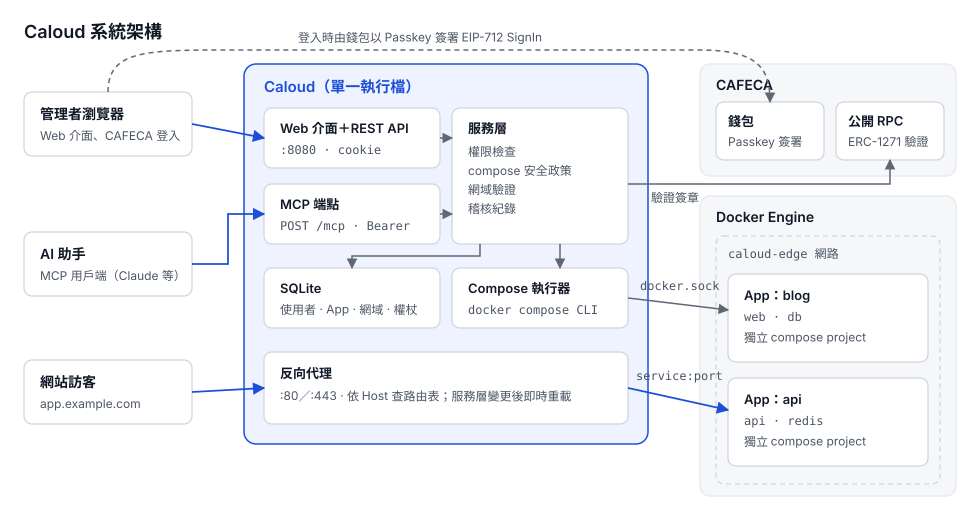
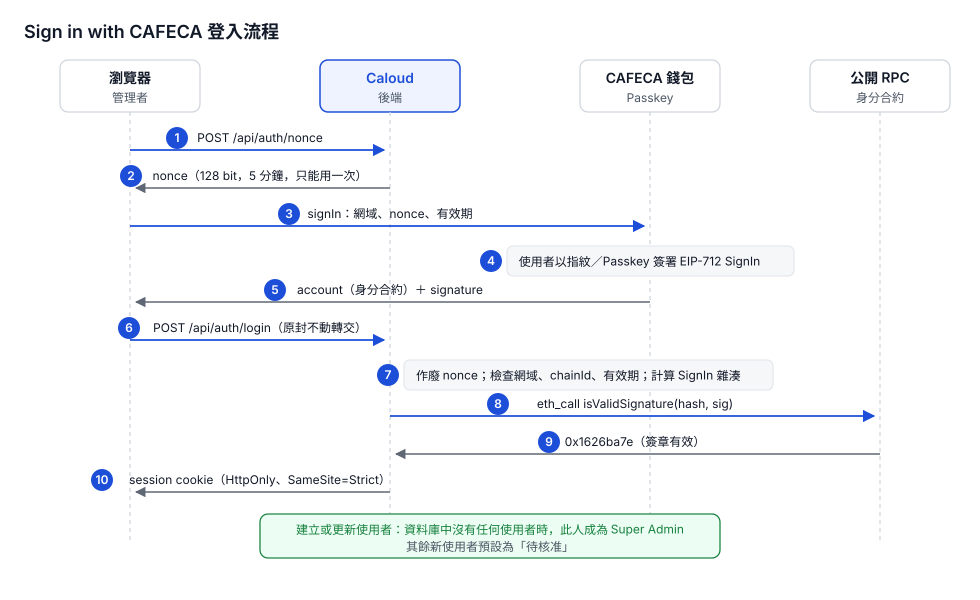

# Caloud

**自架的容器托管平台。** 用 CAFECA 身分登入網頁，有兩種上線方式：

- **專案**：匯入 GitHub 儲存庫。Caloud 會自動解析要怎麼建置與執行，在隔離的環境中驗證；通過後建置並部署到 Runner 節點，開出 HTTPS 網址。之後 push 就會自動驗證與更新，PR 也會收到驗證結果。
- **App**：上傳一份 docker compose 檔，立即在 Caloud 主機上啟動，再把自己的網域轉發過去。

也可以讓 Claude 等 AI 助手透過 MCP 代為操作。

以 Rust 開發，控制面是**單一執行檔**，同時提供管理介面、REST API、MCP 端點與反向代理（Edge）；Runner 節點執行 `caloud-agent`，以 gVisor 隔離用戶的程式。



---

## 目錄

- [適合誰](#適合誰)
- [功能](#功能)
- [運作原理](#運作原理)
- [部署](#部署)
- [操作](#操作)
- [GPU 支援](#gpu-支援)
- [設定](#設定)
- [疑難排解](#疑難排解)
- [專案結構與開發](#專案結構與開發)
- [目前限制與路線圖](#目前限制與路線圖)

## 適合誰

- 團隊的服務都放在 GitHub，想要**推上去就驗證、通過就上線**，不必自己寫 Dockerfile、CI 與部署腳本。
- 有一台 Docker 主機，想讓團隊成員**自助部署**內部工具（Metabase、Grafana、部落格、API 服務…），又不想給每個人 SSH 與 root 權限。
- 想用 **CAFECA 身分**統一登入，不另外管理帳號密碼。
- 想讓 **AI 助手**直接幫忙部署、查 log、設定網域。

## 功能

| 功能 | 說明 | 狀態 |
| --- | --- | --- |
| 匯入 GitHub 儲存庫 | 公開儲存庫貼網址即可；私有儲存庫經 Caloud GitHub App 授權；支援 monorepo 子目錄 | ✅ |
| 自動解析 | 依序採用 `.caloud/compose.yml`、compose、Dockerfile、語言範本（Node、Python、Go、Rust）、靜態網站；每項判斷附信心度與依據（檔案與行號），可編輯 | ✅ |
| 驗證與報告 | 在隔離環境中建置、秘密外洩掃描、相依套件漏洞、lint、專案測試、煙霧測試、log 檢查；與前次比較；報告可下載 | ✅ |
| 部署到 Runner | gVisor 隔離的 BuildKit 建置、gVisor 執行；健康檢查通過後開出 `https://<8 碼>.<網域池>`；未通過驗證不部署 | ✅ |
| GitHub 整合 | push 自動驗證並更新部署；PR 驗證、Checks 與 PR 留言 | ✅ |
| 秘密變數 | 依環境加密保存、只寫不讀、log 遮蔽；資料庫密碼自動產生 | ✅ |
| 發布前任務 | migration、seed 在切換前執行，失敗保留舊版 | ✅ |
| 建置資源與配額 | 後台設定建置 CPU、記憶體與每月建置分鐘 | ✅ |
| GPU 服務 | 從 GitHub 匯入的專案可使用 NVIDIA GPU，在 gVisor 中以 nvproxy 執行，多個環境分時共用（見 [GPU 支援](#gpu-支援)） | ✅ |
| Runner 節點 | 一次性權杖加入、自我檢查（隔離、防火牆、GPU）、依容量調度、排空 | ✅ |
| CAFECA 登入 | Passkey 簽署，後端以公開 RPC 驗證；不需 API key、不需向 CAFECA 註冊 | ✅ |
| 第一位登入者即 Super Admin | 部署後第一個登入的人自動取得最高權限；之後的人預設「待核准」 | ✅ |
| 上傳 compose 即時啟動（App） | 安全檢查 → 加入隔離網路 → `docker compose up`，狀態即時更新 | ✅ |
| 網域托管與轉發 | DNS TXT 驗證擁有權後，把網域轉發到 App 的 service:port，不需重啟 | ✅ |
| 管理介面 | 總覽、Apps、網域、使用者、API 權杖；淺色／深色 | ✅ |
| MCP 介面 | AI 助手以個人 API 權杖經 `POST /mcp` 操作 16 個工具 | ✅ |
| 稽核紀錄 | 登入、部署、網域、角色、權杖變更皆有紀錄，標示來源（網頁／MCP） | ✅ |
| HTTPS 自動憑證 | Let's Encrypt：網域池 wildcard（Cloudflare DNS-01）與已驗證網域（HTTP-01），`:80` 轉 HTTPS | ✅ |
| WebSocket 轉發 | WebSocket 與 HTTP Upgrade；回應以串流轉發（SSE 可用） | ✅ |
| Staging、藍綠發布與回滾、專案自訂網域、專案的 MCP 工具 | | M7 規劃中 |
| 即時 log 串流、使用者配額、方案與計費 | | M3、M8 規劃中 |

## 運作原理

### 1. 登入：Sign in with CAFECA

CAFECA 身分是一個鏈上的智能合約帳戶，由使用者裝置上的 Passkey 控制。Caloud 不保存任何密碼：



- **防重放**：nonce 由 Caloud 產生，5 分鐘內有效且只能用一次。
- **防仿冒網站**：使用者簽署的訊息包含 Caloud 的網域，換到別的網站使用會驗證失敗。
- **不信任任何第三方**：Caloud 自己計算 EIP-712 雜湊，直接向公開 RPC 呼叫使用者身分合約的 `isValidSignature` 驗證。
- **使用者 ID** 就是身分合約地址，換裝置或恢復帳戶後都不變。
- **第一位登入者**：建立使用者時以單一 SQL 陳述式判斷「資料庫是否還沒有任何使用者」，兩人同時登入也只會有一位成為 Super Admin（[ADR 0004](docs/adr/0004-first-login-super-admin.md)）。

### 2. App 部署與流量轉發


- **一個 App ＝ 一個 compose project**，名稱為 `caloud-<id 前 12 碼>`，App 之間網路互相隔離。
- **安全檢查**：Caloud 需要存取 docker.sock（等同主機 root），所以會拒絕可能逃逸到主機的設定，例如 `ports`、`privileged`、`cap_add`、`network_mode: host`、主機路徑掛載、`build`、`env_file`。完整清單見[安全規範 §3](docs/07-security.md#3-compose-政策)。
- **override**：Caloud 替每個 service 加上 `caloud-edge` 網路與 alias `caloud-<id>-<service>`、記憶體與程序數上限、`restart: unless-stopped`。容器不對主機開 port，只能經由 Caloud 的反向代理被存取。
- **熱更新路由**：只有「網域已驗證、已綁定、App 運作中」才進入路由表；任何變更後立即重新載入，不中斷進行中的連線。

### 3. 專案：從儲存庫到上線

控制面（Caloud）負責解析、排程與對外流量，用戶的程式只在 **Runner 節點**上執行。Runner 主動以 WebSocket 連回控制面，不需要對外開 port。

1. **匯入**：取得指定分支的最新 commit。私有儲存庫使用 GitHub App 的 installation token，權杖只經環境變數交給 git。
2. **解析**：產生平臺用的 compose，並列出以下判斷，每項附信心度與依據：
   - 服務、對外服務與 port；
   - 附加資料庫；
   - 環境變數與持久化目錄；
   - 需要的系統套件；
   - 測試指令與發布前任務。

   低信心的項目要在確認頁勾選。只讀不執行（[ADR 0014](docs/adr/0014-analyzer-crate.md)）。
3. **驗證**：每次一個用完即銷毀的驗證環境，依序執行 10 個階段：
   - 取得；
   - 解析；
   - 建置；
   - 靜態檢查：秘密外洩、相依套件漏洞、lint；
   - 啟動；
   - 專案測試；
   - 煙霧測試；
   - log 檢查；
   - 彙整；
   - 銷毀。

   有 Blocker 或 High 問題即未通過（[ADR 0020](docs/adr/0020-verification.md)）。
4. **部署**：依序經過取得原始碼、建置、發布前任務、啟動、健康檢查。
   - 建置：每次在 gVisor 中跑一個臨時 BuildKit，不共用 Docker daemon；
   - 啟動：每個環境有自己的網段與 bridge，防火牆擋下內網、雲端 metadata 與 Runner 主機本身（[ADR 0015](docs/adr/0015-runner-sandbox.md)、[ADR 0018](docs/adr/0018-minimal-deploy.md)）。
5. **對外**：Edge 終結 TLS，經 Runner 主動建立的通道把流量送進環境。

### 4. 網域驗證


必須先證明你擁有網域（TXT 紀錄）才能讓它轉發流量，避免有人綁定別人的網域。

### 5. MCP：讓 AI 助手操作 Caloud


- MCP 用戶端無法完成瀏覽器中的 Passkey 簽署，所以改用在網頁建立的**個人 API 權杖**（[ADR 0008](docs/adr/0008-mcp-interface.md)）。
- 權杖代表你本人，權限永遠等於你**目前**的角色；被改為待核准或停用時立即失效。
- MCP 與網頁共用同一個服務層，權限、compose 安全檢查、錯誤訊息完全一致。

## 部署

### 需求

| 項目 | 版本 |
| --- | --- |
| Linux 主機（控制面） | 可對外提供 80 與 443 port |
| Runner 節點（部署專案才需要） | x86_64 Linux、Docker、iptables、python3；可與控制面同機，建議分機 |
| Docker Engine | 24 以上 |
| Docker Compose plugin | 2.20 以上（需要 `--wait`） |
| 網域 | 每個要托管的網域都要能設定 A 與 TXT 紀錄 |

### 用 Docker Compose 部署（建議）

```bash
git clone <此 repo> caloud && cd caloud
cp deploy/.env.example deploy/.env      # 依下方說明修改
export CALOUD_COMMIT=$(git rev-parse --short HEAD) CALOUD_BUILT_AT=$(date -u +%FT%TZ)   # 建置識別（選填）
docker compose -f deploy/docker-compose.yml up -d --build
docker compose -f deploy/docker-compose.yml logs -f caloud
```

`deploy/docker-compose.yml` 會：

- 對外開放 `80`（轉 HTTPS 與 ACME 驗證）與 `443`（管理介面、App 與專案網址；TLS 終結或 SNI 直通）
- 管理介面另在 `8080` **只綁定主機的 127.0.0.1**，供 SSH 通道備用
- 掛載 `/var/run/docker.sock`，並把資料存在 `caloud-data` volume（SQLite、compose 檔）
- 建立 `caloud-edge` 網路，Caloud 與所有 App 容器都會加入

### 連到管理介面

CAFECA 簽章會綁定管理介面的網址，所以 `CALOUD_PUBLIC_ORIGIN` 必須**和瀏覽器網址列完全相同**；CAFECA 只接受 `https://` 或本機的 `http://localhost`。

建議直接以網域對外（[ADR 0017](docs/adr/0017-github-app-public-console.md)）：

1. 把網域的 A 紀錄指向主機。
2. 在 `deploy/.env` 設定以下兩項，然後重啟：

   ```bash
   CALOUD_PUBLIC_ORIGIN=https://caloud.example.com
   CALOUD_ACME_EMAIL=ops@example.com
   ```

Caloud 會用 HTTP-01 自動申請憑證，Edge 把這個網域轉給管理介面。CAFECA 簽章綁定 origin，改成網域後，經 SSH 通道以 localhost 登入就會失效。

還沒有網域時，可以先用 SSH 通道：

```bash
# deploy/.env
CALOUD_PUBLIC_ORIGIN=http://localhost:8080

# 你的電腦
ssh -L 8080:localhost:8080 <主機>
# 瀏覽器開啟 http://localhost:8080
```

### 第一次登入

> [!IMPORTANT]
> 部署完成後**立即**登入。第一個登入的人會成為 Super Admin，且無法轉移。

1. 開啟管理介面 →「以 CAFECA 登入」→ 在 CAFECA 錢包確認並以 Passkey 簽署。
2. 你現在是 Super Admin。之後登入的人會出現在「使用者」頁等待核准。

### 準備部署專案（Admin）

部署專案還需要下列設定，都在管理介面完成：

| 步驟 | 位置 | 說明 |
| --- | --- | --- |
| 1. 主金鑰 | `deploy/.env` 的 `CALOUD_MASTER_KEY` | 加密秘密變數、Cloudflare 權杖與 GitHub App 機密；用 `openssl rand -base64 32` 產生並離線備份 |
| 2. 網域池 | 「HTTPS 憑證」→「新增網域池」 | 環境網址的根網域（例如 `caloud.example.com`），用途選 production、staging、verify。<br>DNS 加一筆 `*.<根網域>` 的 A 紀錄指向主機。<br>設定 Cloudflare 權杖後以 DNS-01 申請 wildcard 憑證 |
| 3. Runner 節點 | 「Runner 節點」→「加入節點」 | 在 Runner 主機執行畫面上的指令：`sudo scripts/runner-setup.sh install --server <管理介面網址> --join <權杖>`。<br>權杖只顯示一次，60 分鐘內有效。<br>腳本會安裝 gVisor、環境防火牆、建置環境與 agent 服務；以 reload 生效，不重啟主機上既有的容器。<br>節點通過自我檢查後才會接工作 |
| 4. GitHub App（私有儲存庫才需要） | 「GitHub App」 | 在 GitHub 建立 App，把畫面上的 Callback URL 與 Webhook URL 填入；再把 App ID、Client ID、Client secret、Webhook secret、私鑰填回 Caloud，見下方說明 |

GitHub App 的設定：

- **權限**：Contents（Read-only）、Metadata（Read-only）、Checks（Read & write）、Pull requests（Read & write）、Deployments（Read & write）。
- **事件**：Push、Create、Pull request。
- **安裝時要求用戶授權**：勾選「Request user authorization (OAuth) during installation」。

之後變更權限，要在各安裝（組織的 Settings → GitHub Apps）接受新權限才會生效。

### 備份與升級

| 工作 | 做法 |
| --- | --- |
| 備份 | 備份 `caloud-data` volume（`caloud.db`、`apps/`、憑證）與主金鑰；App 自己的資料在各自的具名 volume；專案環境的資料在 Runner 上的具名 volume（備份功能於 M8 規劃） |
| 升級 | `git pull` 後，帶上 `CALOUD_COMMIT`（同上）執行 `docker compose -f deploy/docker-compose.yml up -d --build`；資料庫 migration 於啟動時自動執行。<br>用 `curl https://<管理介面>/api/version` 或側欄底部的版本確認是否已是新版；開著的分頁會提示重新整理 |
| 重啟 | Caloud 重啟不影響已運行的容器；路由表會在啟動時從資料庫載入；Runner 的 agent 會自動重連 |
| 更新 Runner | 以新版映像中的 `/usr/local/bin/caloud-agent` 取代 `/usr/local/lib/caloud/bin/caloud-agent`，再 `systemctl restart caloud-agent` |

### 本機開發執行

```bash
# 需要 Rust 1.82+ 與 Docker
export CALOUD_PUBLIC_ORIGIN=http://localhost:8080
export CALOUD_HTTP_LISTEN=0.0.0.0:8000     # 不需 root 權限
cargo run -p caloud
# 管理介面 http://localhost:8080、元件總覽 http://localhost:8080/styleguide
```

## 操作

### 核准使用者

「使用者」頁會列出所有登入過的人，待核准者排在最前面，側欄也會顯示人數。把角色改為 **Member** 即可讓對方部署。

| 角色 | 可以做什麼 |
| --- | --- |
| Super Admin | 全部，包括授予／撤銷 Admin。全站唯一，不可變更 |
| Admin | 管理所有人的專案、App 與網域，核准或停用使用者；管理 Runner 節點、網域池、GitHub App 與建置資源；可強制部署未通過驗證的版本（留稽核） |
| Member | 管理自己的專案、App、網域與 API 權杖 |
| 待核准 | 只能看到「等待核准」畫面 |
| 已停用 | 立即登出，API 權杖失效 |

### 匯入專案

1. 「專案」→「匯入專案」，二擇一：
   - **私有儲存庫**：先按「連結 GitHub」安裝 Caloud GitHub App，選擇要授權的儲存庫，再從列表選擇。
   - **公開儲存庫**：直接貼上 `https://github.com/<owner>/<repo>`。
2. 選填：
   - 分支，預設為儲存庫的預設分支；
   - 根目錄，monorepo 指定子目錄，例如 `apps/web`。
3. 按「匯入並解析」。幾秒到數十秒後顯示解析結果。

每位使用者最多 20 個專案，checkout 後的儲存庫上限 1 GB。

### 確認解析結果

解析結果頁有三張表：

| 區塊 | 內容 |
| --- | --- |
| 偵測到的服務 | 每個服務的類型（App、資料庫、快取、附加服務）、port；選擇**對外服務**（Edge 路由到它）。宣告 GPU 的服務顯示「GPU」徽章 |
| 判斷與依據 | 每項判斷的信心度（高／中／低）與依據檔案、行號；**低信心**的項目要勾選「我已確認」 |
| 環境變數 | 平臺自動提供（`PORT`、`DATABASE_URL`…）、平臺產生（資料庫密碼）、需要你提供的變數；標示「建置時」寫入前端的變數 |

產生的 compose 可以直接編輯，例如改映像版本、加 volume、宣告 GPU。確認後才能驗證與部署。

不想讓 Caloud 猜測時，在儲存庫放 `.caloud/compose.yml`，Caloud 會直接採用（仍須通過[平臺政策](docs/07-security.md#36-平臺-app-政策)）。

之後儲存庫的設定改變時，重新解析的結果需要再確認一次。在確認之前，部署沿用已確認的版本。

### 環境變數（秘密變數）

在專案頁的「環境變數」表填值，production 與 staging 分開設定（[ADR 0019](docs/adr/0019-project-vars.md)）：

- **只寫不讀**：以主金鑰加密保存，畫面只顯示末 4 碼，log 與報告自動遮蔽。
- **只注入你建置的服務**：不會注入資料庫等現成映像；建置時變數會以 build arg 帶入。
- **不寫入檔案**：值只經行程環境變數交給 `docker compose`，不寫入 compose 或任何檔案。
- **資料庫密碼**：第一次部署時自動產生，不可修改。
- **生效時機**：修改後專案頁會提示，**重新部署**才生效。
- **PR 驗證不注入任何變數**：PR 的程式碼可能來自 fork。

### 驗證與報告

按驗證卡片的「驗證」，或直接部署時自動先驗證（[ADR 0020](docs/adr/0020-verification.md)）：

- **階段**：取得、解析、建置、靜態檢查、啟動、測試、煙霧測試、日誌、彙整、銷毀，畫面即時更新。
- **靜態檢查**：
  - 秘密外洩，例如 AWS 金鑰、私鑰；
  - 相依套件漏洞，以 osv-scanner 檢查；
  - lint。
- **專案測試**：測試指令與 lint 依專案偵測，也可在 `.caloud/verify.yml` 指定，在 gVisor 沙箱中執行。
- **其他階段**：
  - 煙霧測試：對外服務回 5xx 或沒有回應時列為問題；
  - 日誌：檢查致命錯誤與重啟。
- **判定**：問題分 Blocker、High、Medium、Low，**有 Blocker 或 High 即未通過**。
- **報告**：報告頁列出每個問題的檔案與行號，並與前一次比較，標出新增與已修正的問題。可下載 Markdown 與 JSON。
- **保留環境**：勾選「失敗時保留環境 30 分鐘」，可以在失敗後檢查環境。
- **新的執行會取消舊的**：同一分支有新的驗證時，舊的會被取消。

### 部署專案

按「部署」。版本已通過驗證時直接部署，否則顯示「驗證並部署」，先驗證、通過後才部署。

部署依序經過：

1. **取得原始碼**；
2. **建置**：gVisor BuildKit；
3. **發布前任務**：migration、seed；
4. **啟動**；
5. **健康檢查**：對外服務在時限內回應。

畫面顯示目前階段與 log。完成後開出 `https://<8 碼>.<網域池>`。

- **失敗不影響線上版本**：取得、建置或發布前任務失敗時，正在執行的舊版不受影響。
- **發布前任務**：來源依序為 `.caloud/verify.yml` 的 `release`、compose 中帶 `profiles` 的 migrate／seed 服務、Prisma migrations。這些任務以新設定執行，成功後才啟動新版。
- **強制部署**：Admin 可以跳過驗證，會留下稽核紀錄。
- **建置配額**：建置與驗證沙箱使用的 CPU、記憶體由 Admin 在「Runner 節點」頁的「建置資源」設定。每月建置分鐘依專案擁有者計算，用完時驗證與部署會回錯誤；專案頁顯示本月用量。

- **確認線上版本**（[ADR 0023](docs/adr/0023-versions.md)）：
  - 專案頁分開顯示「執行中」與「正在部署」的版本。執行中的版本只在健康檢查通過後更新；部署失敗時，會標出仍在執行哪一版。
  - 專案頁也顯示分支最新的 commit 與它的驗證狀態，並以容器實際的映像核對版本。
  - 「部署紀錄」列出最近 20 次部署的版本、來源與結果。
  - 網站回應帶 `X-Caloud-Commit`（前 7 碼），用 `curl -sI https://<網址>` 就能確認；不想公開時可在專案頁關閉。
  - 以 GitHub App 匯入的專案，部署狀態會同步到 GitHub 的 Deployments（environment `production`）。
- **App 可讀的版本資訊**：
  - 從儲存庫建置的服務會拿到 `CALOUD_COMMIT`、`CALOUD_COMMIT_SHORT`、`CALOUD_BRANCH`、`CALOUD_ENV`、`CALOUD_DEPLOYED_AT`，同時作為執行期環境變數與 build arg；
  - 前端要把版本寫進建置結果時，在 Dockerfile 宣告 `ARG CALOUD_COMMIT`。

```yaml
# .caloud/verify.yml（選填）
test:
  command: npm test
  setup: npm ci                 # 選填；image 也可指定
lint:
  command: npm run lint
smoke: [/, /health]             # 煙霧測試的路徑
release:
  - service: migrate            # compose 中帶 profiles 的一次性服務
  - service: web
    command: npx prisma migrate deploy
```

### GitHub 自動化

以 GitHub App 匯入的專案（[ADR 0021](docs/adr/0021-checks-quota-release.md)）：

| 事件 | Caloud 的動作 |
| --- | --- |
| push 到專案分支 | 重新解析並驗證；專案已部署且驗證通過時，自動更新 production |
| 開啟 PR，或 PR 有新的 commit（base 為專案分支） | 以已確認的設定驗證 PR 的 head：不部署、不注入秘密變數；在 PR 留一則摘要留言，之後的結果更新同一則 |
| 任何驗證 | 在該 commit 建立「Caloud 驗證」Check（✓／✗），Details 連到報告 |

### 部署 App（上傳 compose）

App 直接在 Caloud 主機上以 Docker 執行，適合現成映像的內部工具。需要從原始碼建置、驗證或 GPU 時，請改用專案。

1. 「Apps」→「新增 App」，選擇或貼上 compose 檔，按「建立並部署」。
2. 列表上的狀態會從「部署中」變為「運作中」或「失敗」。點一下列可開啟詳細：容器狀態、compose 編輯、Logs。

compose 範例：

```yaml
services:
  web:
    image: ghost:5-alpine
    environment:
      url: http://blog.example.com
    volumes:
      - content:/var/lib/ghost/content
volumes:
  content: {}
```

> [!NOTE]
> 不要寫 `ports`：對外流量一律經由網域轉發。需要設定檔時請用 `environment` 或建置好的映像，不可掛載主機路徑。

### 綁定網域

1. 「網域」→「新增網域」，輸入 `blog.example.com`。
2. 依畫面到你的 DNS 服務商新增兩筆紀錄（可一鍵複製）：
   - `A  blog.example.com → Caloud 主機 IP`
   - `TXT  _caloud-challenge.blog.example.com = caloud-…`
3. 按「驗證」（DNS 生效可能需要幾分鐘）。
4. 選擇 App、service 與容器內 port（上例為 `web`、`2368`）→「套用」。開啟 `http://blog.example.com` 即可看到服務。

### 使用 MCP（AI 助手）

1. 「API 權杖」→「建立權杖」，命名（例如 Claude Code）並選擇有效期限。**權杖只顯示一次**。
2. 加入 MCP 用戶端，例如 Claude Code：

   ```bash
   claude mcp add --transport http caloud https://<管理介面網址>/mcp \
     --header "Authorization: Bearer cld_…"
   ```

   其他支援 HTTP 傳輸的用戶端可使用畫面上提供的 `.mcp.json` 設定。
3. 直接對 AI 助手下指令，例如「把這份 compose 部署成 blog，並綁定 blog.example.com 的 2368 port」。

| 工具 | 用途 |
| --- | --- |
| `whoami` | 目前身分與角色 |
| `list_apps`、`get_app`、`get_app_logs` | 查詢 App、容器狀態與 log |
| `create_app`、`create_git_app`、`update_app`、`deploy_app`、`stop_app` | 建立（上傳 compose 或 Git 來源）、更新、部署、停止 |
| `delete_app` | 刪除 App（需 `confirm: true`） |
| `list_domains`、`create_domain`、`verify_domain`、`bind_domain` | 網域設定流程 |
| `delete_domain` | 刪除網域（需 `confirm: true`） |
| `list_users`、`set_user_role` | 僅 Admin 以上 |

目前 MCP 只涵蓋 App、網域與使用者；專案的匯入、驗證與部署工具在 M7-07 規劃中。完整規格見 [API 規格 §5](docs/06-api-spec.md#5-mcp-介面)。不再使用的權杖請在「API 權杖」頁撤銷。

## GPU 支援

從 GitHub 匯入的**專案**可以使用 NVIDIA GPU：例如模型推論、影像與影片處理、向量運算。設計與風險見 [ADR 0022](docs/adr/0022-gpu.md)。

### 目前狀況

| 項目 | 狀況 |
| --- | --- |
| 可用的 GPU 節點 | `cafeca-dev-004`：1 張 NVIDIA GeForce RTX 4060 Ti 16 GB，驅動 580.178.04 |
| 執行方式 | gVisor（`runsc --nvproxy`）隔離，GPU 以 CDI 裝置 `caloud.dev/gpu=all` 掛入；已實測 CUDA 範例在 gVisor 中通過 |
| 誰可以用 | 所有 Member（之後依方案開放） |
| 適用範圍 | production、staging、驗證環境，以及驗證的測試與 lint 沙箱 |
| 不支援 | 上傳 compose 建立的 App、建置過程（Dockerfile 的 `RUN`）、漏洞掃描；graphics 與 video 能力（Vulkan、OpenGL、NVENC／NVDEC） |

GPU 是否就緒，可在「Runner 節點」頁的自我檢查欄查看：顯示「GPU 就緒」，或「GPU 未就緒」加上原因。

### 如何使用

在 compose 中，替需要 GPU 的服務加上宣告：

```yaml
services:
  infer:
    build: .
    expose: [8000]
    deploy:
      resources:
        reservations:
          devices:
            - capabilities: [gpu]
```

儲存庫沒有 compose，只有 Dockerfile 或語言範本時，解析器偵測到下列訊號會自動加上宣告：

- CUDA 基底映像：`nvidia/cuda`、`nvcr.io/nvidia/…`、含 `cuda` 的 `pytorch/pytorch`、含 `gpu` 的 `tensorflow/tensorflow`；
- GPU 套件：`onnxruntime-gpu`、`onnxruntime-node-gpu`、`@tensorflow/tfjs-node-gpu`、`cupy-cuda*`。

自動加上的宣告列為**低信心**，確認頁需要勾選；不需要 GPU 時，編輯 compose 刪掉即可。宣告 GPU 的服務在確認頁會顯示「GPU」徽章。

### 使用規範

1. **只能用標準宣告。**
   - `devices` 每一項都必須是 `capabilities: [gpu]`，`driver` 只能是 `nvidia`。
   - `count`、`device_ids`、`options` 會被忽略：一律使用節點上所有 GPU。
   - 不可使用 `devices:`（主機裝置）、`runtime`、`privileged`。
2. **GPU 是共用的，顯示記憶體不隔離。** 同一張卡上的其他環境可能把顯示記憶體用完，你的服務也可能看得到別人的用量。請做到：
   - **限制自己的用量**：例如 PyTorch 的 `torch.cuda.set_per_process_memory_fraction()`、TensorFlow 的 memory growth，或推論伺服器的顯示記憶體上限設定。
   - **能處理 CUDA OOM**：失敗時回錯誤或重試，不要讓整個服務崩潰。
   - **閒置時釋放顯示記憶體**：不要預先佔滿整張卡。
3. **只開放 compute 與 utility 能力**：CUDA、cuDNN、`nvidia-smi` 可以用；圖形 API 與硬體影音編解碼不能用。
4. **映像**：
   - 使用 CUDA **runtime** 映像，不要用 devel；CUDA 映像通常有數 GB，Runner 磁碟有限；
   - 映像的 CUDA 版本不可高於節點驅動支援的版本，驅動版本見「Runner 節點」頁。
5. **建置時沒有 GPU**：Dockerfile 的 `RUN` 不能執行需要 GPU 的步驟（例如模型量化、驗證 CUDA）。這些步驟請改在服務啟動時，或在發布前任務中執行。
6. **其他資源上限不變**：CPU、記憶體、pids 與一般服務相同，GPU 不會讓服務多拿到主機記憶體。
7. **安全責任**：
   - nvproxy 會把驅動呼叫交給主機核心，GPU 驅動的漏洞可能影響主機；
   - 不要部署來源不明的 CUDA 程式或映像；
   - 平臺會保持驅動與 gVisor 更新。

### 管理者

- **啟用 GPU**：Runner 主機執行 `sudo scripts/runner-setup.sh install`。偵測到 NVIDIA GPU 時，腳本會：
  1. 安裝 NVIDIA 官方的 nvidia-container-toolkit；
  2. 產生 `/etc/cdi/caloud-gpu.json`；
  3. 註冊 Docker runtime `runsc-gpu`；
  4. 以 reload 生效，不重啟既有容器。
- **前提**：驅動版本必須在 `runsc nvproxy list-supported-drivers` 中，否則略過 GPU 設定。
- **更新驅動後**：重新執行 `runner-setup.sh install`，並重啟 `caloud-agent`。在這之前，GPU 自我檢查不會通過，平臺也不會排入 GPU 環境。
- **查看狀態**：`sudo scripts/runner-setup.sh status` 列出 GPU、nvproxy 支援、nvidia-ctk 與 CDI 規格；`caloud-agent --self-check` 會輸出 `gpu_ready` 與原因。

## 設定

所有設定皆為環境變數（前綴 `CALOUD_`），範例見 `deploy/.env.example`。

| 變數 | 預設 | 說明 |
| --- | --- | --- |
| `PUBLIC_ORIGIN` | `http://localhost:8080` | 管理介面 origin，**必須與網址列完全相同** |
| `API_LISTEN` | `0.0.0.0:8080` | 管理介面、REST API、MCP |
| `HTTP_LISTEN` | `0.0.0.0:80` | 反向代理 HTTP |
| `HTTPS_LISTEN` | `0.0.0.0:443` | 反向代理 HTTPS（SNI 直通或終結 TLS） |
| `CAFECA_WALLET` | `https://cafeca.io` | CAFECA 錢包網址（讀取 `/.well-known/cafeca-configuration`） |
| `CAFECA_RPC` | — | 覆寫 RPC，建議使用自架或付費節點 |
| `DATA_DIR` | `./data`（容器內 `/data`） | SQLite、compose 檔、憑證 |
| `EDGE_NETWORK` | `caloud-edge` | 被代理容器加入的 docker 網路 |
| `DEFAULT_ROLE` | `pending` | 第一位以外的新使用者角色（`pending` 或 `member`） |
| `ACME_EMAIL` / `ACME_STAGING` | — / `false` | Let's Encrypt 聯絡信箱（未設定時不申請憑證）／改用 staging |
| `MASTER_KEY` | — | 祕密加密主金鑰（32 bytes base64，`openssl rand -base64 32`）；設定 Cloudflare 權杖前必須設定，遺失後需重新設定權杖 |
| `CLOUDFLARE_API` | `https://api.cloudflare.com/client/v4` | Cloudflare API 端點（測試用） |
| `ACME_DIRECTORY` / `ACME_CA_FILE` | — | 覆寫 ACME directory 與其 CA（測試用 Pebble 等） |
| `GITHUB_API` / `GITHUB_WEB` | `https://api.github.com` / `https://github.com` | GitHub API 與網站網址（測試用替身）；GitHub App 憑證在後台設定（ADR 0017） |
| `DOCKER_BIN` | `docker` | docker CLI 路徑 |
| `DOH_URL` | `https://cloudflare-dns.com/dns-query` | 網域 TXT 驗證使用的 DNS-over-HTTPS 端點（JSON API） |
| `GIT_BIN` | `git` | git CLI 路徑（Git 來源 App、專案匯入） |
| `DEPLOY_HEALTH_SECS` | `60` | 專案部署健康檢查的等待秒數 |
| `RUST_LOG` | `info,caloud=debug` | log 層級 |

## 疑難排解

| 狀況 | 原因與處理 |
| --- | --- |
| 登入時顯示「網域不符」 | `CALOUD_PUBLIC_ORIGIN` 與瀏覽器網址列不同（含 port、http／https），修正後重啟 |
| 登入彈出視窗被擋 | 允許此網站的彈出視窗後再按一次 |
| 「nonce 無效或已過期」 | 登入視窗停留超過 5 分鐘，重新按「以 CAFECA 登入」 |
| 建立 App 回「不允許使用 `ports`」等 | compose 含被禁止的設定，依訊息移除；對外流量改用網域綁定 |
| App 狀態為「失敗」 | 在 App 詳細的 Logs 或錯誤訊息查看原因，常見為映像名稱錯誤或拉取失敗 |
| 網域驗證找不到 TXT | DNS 尚未生效，或紀錄名稱少了 `_caloud-challenge.` 前綴；用 `dig TXT _caloud-challenge.<網域>` 確認 |
| 網域開啟顯示 404「尚未綁定運作中的 App」 | 網域未驗證、未綁定，或 App 不是運作中 |
| 網域開啟顯示 502 | 綁定的 port 不是容器實際監聽的 port，或容器尚未就緒 |
| 匯入私有儲存庫解析失敗「Repository not found」 | GitHub App 缺 **Contents（Read-only）** 權限、儲存庫不在安裝的授權範圍，或變更權限後組織尚未接受；修正後按「重新解析」 |
| push 或 PR 沒有觸發驗證 | GitHub App 的「Subscribe to events」沒有勾選 Push 或 Pull request；在 App 設定的 Advanced → Recent Deliveries 可看到事件與回應。PR 的 base 必須是專案分支 |
| commit 上沒有出現「Caloud 驗證」Check | 只有以 GitHub App 匯入的專案會回寫；App 需要 Checks（Read & write）權限，且安裝已接受 |
| 部署或驗證回「沒有可用的 Runner 節點」 | 沒有在線、通過自我檢查且容量足夠的節點：到「Runner 節點」頁看自我檢查的原因，或以 `caloud-agent --self-check` 在節點上檢查 |
| 驗證或部署回「本月建置分鐘已用完」 | 達到「建置資源」設定的每月上限；請 Admin 調整，或等下個月（UTC 月初重算） |
| 驗證未通過 | 打開報告看 Blocker 與 High 問題的檔案與行號；建置失敗看「建置」階段的 log |
| 部署停在「發布前任務」失敗 | migration 或 seed 執行失敗，舊版仍在執行；看部署 log 修正後重新部署 |
| 改了環境變數但服務沒變 | 秘密變數要重新部署才生效 |
| MCP 回 401 | 權杖錯誤、已撤銷、已過期，或使用者被改為待核准／停用 |
| 部署 GPU 專案回「沒有可用 GPU 的 Runner 節點」 | 沒有 GPU 自我檢查通過的節點：到「Runner 節點」頁看「GPU 未就緒」的原因，常見為驅動更新後未重新執行 `runner-setup.sh install` |
| GPU 服務出現 `CUDA out of memory` | 顯示記憶體由同一張卡上的環境共用；限制自己的用量，並在 OOM 時重試 |
| 容器內 `cudaGetDeviceCount` 失敗或版本不符 | 映像的 CUDA 版本高於節點驅動支援的版本，請改用較舊的 CUDA runtime 映像 |

## 專案結構與開發

```
crates/
  caloud/               執行檔進入點
  caloud-core/          設定、SQLite、資料模型、migrations
  caloud-auth/          Sign in with CAFECA 驗證
  caloud-orchestrator/  compose 安全政策、環境沙箱 override、docker compose 與 git 執行
  caloud-proxy/         Edge：反向代理、TLS 終結與 SNI 直通、Runner 通道
  caloud-analyzer/      儲存庫解析器（只讀不執行）
  caloud-runner/        caloud-agent：Runner 節點的自我檢查、建置、部署、驗證
  caloud-api/           服務層、REST API、MCP、GitHub App、內嵌網頁
web/                    管理介面（index.html）、元件總覽（styleguide.html）、Design System（ds/）
deploy/                 Caloud 本體的 docker compose 與 .env 範例
docs/                   規格文件（唯一規格來源）與圖示原始碼（docs/images/src/）
scripts/check-docs.sh   文件遵循檢查
scripts/runner-setup.sh Runner 主機設定（gVisor、環境防火牆、建置環境、GPU、agent 服務）
```

本專案**文件先行、按圖施工**：先修改 [docs/](docs/README.md)，再寫程式，兩者放在同一個 PR。開始前請讀 [AGENTS.md](AGENTS.md) 與 [CONTRIBUTING.md](CONTRIBUTING.md)。

```bash
cargo fmt --all --check
cargo clippy --all-targets -- -D warnings
cargo test                    # 含 API 整合測試（模擬錢包、DNS、GitHub、docker 與 Runner）
scripts/check-docs.sh         # 程式與文件一致性檢查
docs/images/src/build.sh      # 重新產生 README 圖示
```

| 文件 | 內容 |
| --- | --- |
| [01 需求規格](docs/01-requirements.md) | 功能與非功能需求、驗收條件 |
| [02 系統架構](docs/02-architecture.md) | 元件、流程、資料模型 |
| [03 開發計劃](docs/03-development-plan.md) | 里程碑與工作項目 |
| [04 設計語言](docs/04-design-language.md) | Design Token、文案、無障礙 |
| [05 通用元件](docs/05-components.md) | 前端元件與後端共用模組 |
| [06 API 規格](docs/06-api-spec.md) | REST 與 MCP |
| [07 安全規範](docs/07-security.md) | 威脅模型、權限矩陣、compose 政策 |
| [08 開發規範](docs/08-coding-standards.md) | 程式風格、測試、Git |
| [adr/](docs/adr/) | 架構決策紀錄（GPU：[0022](docs/adr/0022-gpu.md)） |

## 目前限制與路線圖

**專案目前只有 production 環境**：
- staging、藍綠發布與回滾、部署關卡（M7-01、M7-02）尚未完成；
- 專案的網址為網域池的 8 碼子網域，自訂網域（M7-04）尚未支援；
- 專案環境的 volume 備份與還原在 M8 規劃中。

**App 與控制面**：
- App 在控制面主機上以 Docker 執行（不經 gVisor）。docker.sock 等同主機 root，compose 安全檢查是第一道防線。正式環境建議再搭配 rootless Docker 或 userns-remap，並只核准受信任的使用者為 Member。
- 每個 App 的服務記憶體固定 1 GB、512 pids，尚不能依 App 調整。
- App 的 compose 與 `.env` 以明文保存在控制面；密碼請改用專案的秘密變數。
- 同一 App 同時部署沒有互斥鎖（M2-05）；尚無即時 log 串流（M3-02）。

**其他**：
- 不支援私有映像庫的憑證：映像需公開，或改用專案從原始碼建置。
- MCP 尚未涵蓋專案（M7-07）。

已完成的項目：
- HTTPS 自動憑證與 HTTP 轉 HTTPS；
- 管理介面以網域對外；
- WebSocket 與串流轉發；
- GitHub 匯入、驗證與部署；
- GPU。

完整計劃見[開發計劃](docs/03-development-plan.md)。
